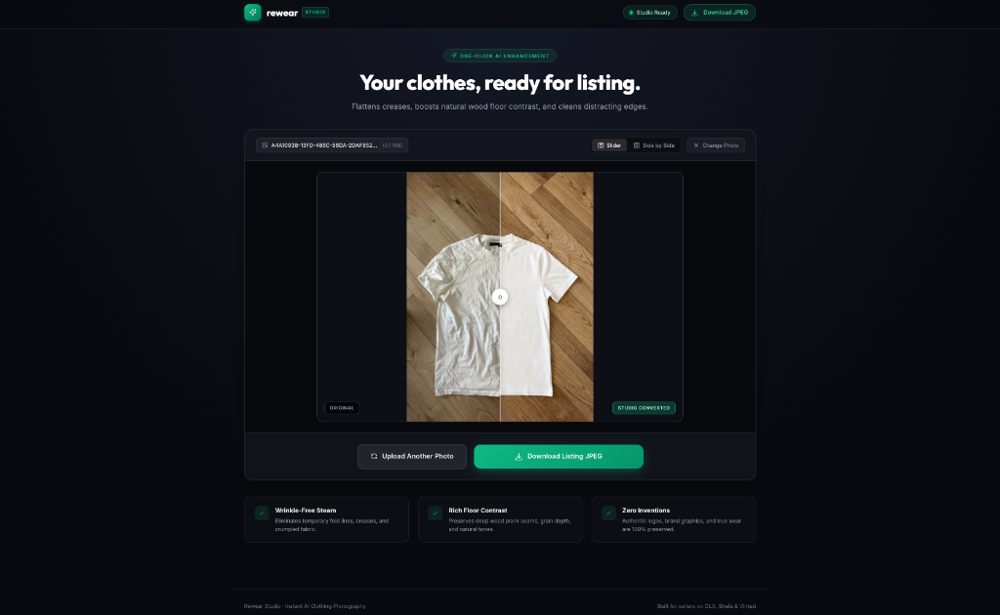
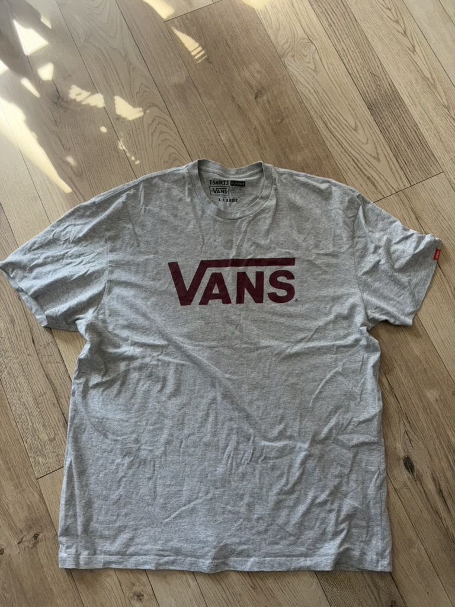
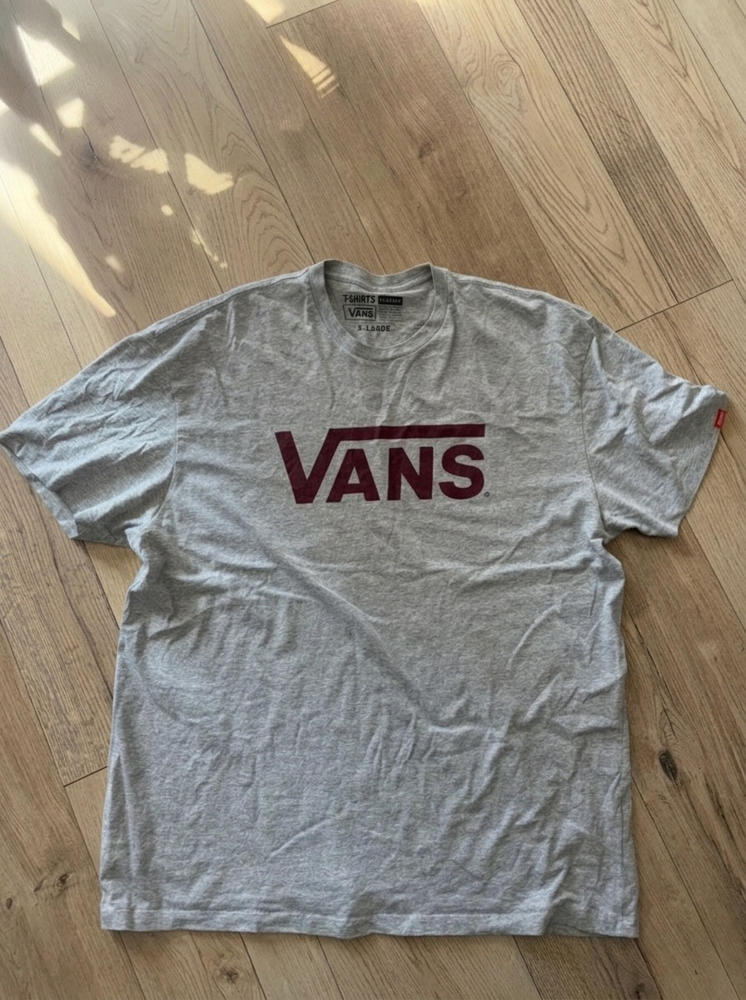

# Rewear Studio — One-Click AI Clothing Photography

> Transform flat-lay clothing photos into professional marketplace listings for OLX, Shafa & Vinted. Substantially flattens creases, boosts natural floor contrast, cleans edge clutter, and preserves 100% of authentic garment identity.



---

## ⚡️ Before & After

| Original Photo (Untouched) | Studio Converted (Listing Ready) |
| :---: | :---: |
|  |  |
| *Temporary creases, crumpled folds, and muted floor lighting* | *Steamed flat, vibrant floor contrast, and crisp fabric highlights* |

---

## ✨ Key Features

- **💨 Wrinkle-Free Steaming**: Substantially eliminates temporary fold lines, bunching, and crumpled creases as if the garment were professionally steamed and laid flat.
- **🪵 Rich Floor Contrast & Daylight**: Brightens the scene with clean, luminous studio daylight while boosting depth between lighter and darker wood planks, deep seams, and natural grain without synthesizing fake textures.
- **🎯 100% Authentic Preservation**: Never invents tags, labels, or graphics. Preserves genuine brand logos, wordmarks, fabric weave, and actual wear (pilling, fading, stains).
- **🧹 Clean Borders**: Automatically detects and eliminates edge clutter such as chair legs, wheels, and distracting peripheral shadows.
- **🎚 Interactive Comparison**: Real-time draggable slider comparison and side-by-side view to inspect details before downloading.
- **📋 Clipboard & Drag-and-Drop**: Paste directly from clipboard (`Cmd+V` / `Ctrl+V`) or drop images straight into the browser.
- **🔒 Privacy First**: Photos are processed directly through Google's Gemini API and never saved to a database or local disk.

---

## 👕 Universal Garment Support

The studio prompt is engineered to handle all clothing categories and fabric weights:

| Category | Targeted Areas & Treatment |
| :--- | :--- |
| **Tops & Shirts** | T-shirts, shirts, polo shirts, blouses, knitwear — smooths torso, chest, body, and sleeves. |
| **Sweaters & Hoodies** | Hoodies, sweatshirts, pullovers, cardigans — relaxes heavy fleece/knit creases across body, hood, and pockets. |
| **Outerwear** | Jackets, denim jackets, blazers, windbreakers, coats — eliminates fold lines while preserving structured seams and hardware. |
| **Bottoms** | Jeans, trousers, sweatpants, joggers, shorts, skirts — removes knee rumples, leg fold lines, and bunching along both legs, thighs, and hems. |
| **Dresses & One-pieces** | Dresses, jumpsuits, overalls — smooths continuous fabric from collar to hemline. |
| **Diverse Fabrics** | Calibrated for light cotton jersey, heavy denim, textured knitwear, fleece, linen, wool, and synthetics. |

---

## 🚀 Quick Start

### Prerequisites

- **Node.js** 20.19+ or 22.12+
- **Yarn** 1.22+
- A **Google Gemini API Key** (from [Google AI Studio](https://aistudio.google.com))

### 1. Installation

```bash
git clone https://github.com/your-username/clothing-photo-studio.git
cd clothing-photo-studio
yarn install
```

### 2. Environment Configuration

Copy the example environment file:

```bash
cp .env.example .env
```

Add your Gemini API key to `.env`:

```env
VITE_APP_GEMINI_API_KEY=your_gemini_api_key_here
VITE_APP_IMAGE_MODEL=gemini-nano-banana-2.1
VITE_APP_IMAGE_SIZE=2K
```

### 3. Run Development Server

Start both the Vite client (`http://127.0.0.1:5173`) and the backend editing server (`http://127.0.0.1:8787`):

```bash
yarn dev
```

Open your browser at [http://127.0.0.1:5173](http://127.0.0.1:5173).

---

## 🧪 Testing & Production Build

### Run Automated Tests

The test suite validates prompt constraints, upload validation, origin security, and API response formatting using Node's built-in test runner:

```bash
yarn test
```

### Production Build

```bash
yarn build
yarn start
```

The production server will listen on [http://127.0.0.1:8787](http://127.0.0.1:8787).

---

## 🛠 Tech Stack

- **Frontend**: [React 19](https://react.dev/), [TypeScript](https://www.typescriptlang.org/), [Vite](https://vitejs.dev/), Vanilla CSS
- **Backend**: Node.js HTTP Server (`server/app.mjs`) & [Vercel Serverless Function](https://vercel.com/) (`api/edit.js`)
- **AI Processing**: Google Gemini Interactions API (`gemini-nano-banana-2.1`) with 2K JPEG rendering

---

## 📄 License

MIT
